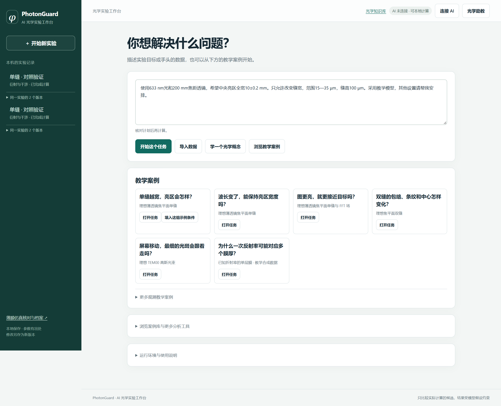

# PhotonGuard

**AI 光学学习与实验工作台** · `0.2.0rc28`（预发布） · GPL-2.0-or-later

从一句实验目标开始，比较实际计算结果，再带着问题继续学习。PhotonGuard 将条件整理、计算计划、光学图表、知识检索和连续问答放在同一工作台中。

[下载项目](https://github.com/zhou2022f1/PhotonGuard/archive/refs/heads/main.zip) · [快速开始](#快速开始) · [使用指南](docs/使用指南.md) · [学习与实验](docs/学习与实验指南.md) · [问题反馈](https://github.com/zhou2022f1/PhotonGuard/issues)



## 可以做什么

- **描述目标，生成计划。** 用自然语言给出条件、目标和可调参数；AI 整理资料，工作台核对原文出处、单位与缺项。
- **比较光学方案。** 支持薄膜、单／双缝衍射和高斯光束，输出候选表、曲线与二维光强。新的实验求解由用户核对并批准。
- **接着修改实验。** 保留固定条件和历史版本，调整目标或准备对照；已有数值满足新评价需求时可以复用结果。
- **带着结果问助教。** 解释概念、公式和当前图表，继续追问，或把问题接到下一次实验。
- **独立学习光学。** 内置 1,011 条知识和 31 个专题，可以离线检索正文、公式及来源；连接 AI 后可连续讲解。
- **从数据继续分析。** 导入 CSV、核对单位和已知条件，筛选参数候选，安排允许范围内的补充观测。
- **保存和复用。** 导出实验记录、数组、图表与重跑配置，也可以扩展知识包。

| 场景 | 设计与比较 | 数据分析 |
|---|---|---|
| 薄膜 | 比较膜系和波长下的反射、透射 | 已知折射率及入射条件下，使用校准反射率筛选膜厚候选 |
| 衍射 | 单缝、双缝中心曲线与二维光强 | 根据带刻度的双缝强度数据估计指定几何参数 |
| 高斯光束 | 比较透镜条件、传播曲线和屏幕光斑 | 根据纵向光斑半径数据估计束腰参数 |

AI 负责理解目标、组织方案和解释结果；实验结果与登记公式的关键数值由程序核算。PhotonGuard 组织条件来源、执行计划和跨轮版本，NumPy、SciPy、tmm 等工具完成对应数值计算。

## 快速开始

### Windows x64

1. [下载完整 ZIP](https://github.com/zhou2022f1/PhotonGuard/archive/refs/heads/main.zip)，选择“全部解压”，保留 `app/`、`materials/` 和 `docs/`。
2. 尚未安装 Ubuntu WSL 时，双击 **首次准备环境.bat**，按提示完成安装、重启和 Ubuntu 账户初始化。
3. 双击 **启动工作台.bat**。首次联网准备锁定依赖，之后复用本机缓存；启动成功后浏览器自动打开。
4. 可先使用本地示例和知识库；需要 AI 时，点击 **连接 AI**，填写自己的 DeepSeek API Key。
5. 使用完毕，双击 **停止工作台.bat**。

启动器使用 Windows x64 + Ubuntu WSL。Linux 用户可按[源码运行说明](app/source/README.md)启动。首次依赖下载失败时，检查网络后重新运行；浏览器拒绝连接时，查看启动窗口给出的状态和地址。

### 只看示例结果

下载解压后，双击 **查看示例结果.html**。可直接查看保存的单缝与薄膜结果，无需 Python 或 API Key。工作台中的本地规则整理、知识检索和登记公式也可离线使用。

## 试一个单缝实验

首页点击 **填入这组示例条件 → 开始这个任务**。固定波长 633 nm、焦距 200 mm、缝高 100 μm，只比较 16、20、24 μm 三个缝宽，目标是中心到第一暗纹 6.33±0.05 mm。

选择本地规则整理，或连接 AI 后选择 AI 整理；两种入口可独立使用。核对条件与计划，再批准计算。

| 缝宽 | 中心到第一暗纹 | 目标判定 |
|---|---:|---|
| 16 μm | 7.9125 mm | 超出目标范围 |
| **20 μm** | **6.3300 mm** | **达到目标** |
| 24 μm | 5.2750 mm | 超出目标范围 |


第一暗纹指标按 λf/a 计算，曲线与二维图来自保存的 NumPy FFT 数组。完整操作见[单缝入门示例](docs/单缝入门示例.md)，保存数据见[示例记录](materials/单缝示例记录.json)。

也可以直接给出目标：

> 使用 633 nm 光和 200 mm 焦距透镜，希望中央亮区全宽 10±0.2 mm。只允许改变缝宽，范围 15—35 μm，缝高 100 μm。采用教学模型，其他设置请帮我安排。

运行后继续说“让中央亮区再宽 50%，光源和透镜不变”，查看预览并核对新计划。见[单缝连续实验](docs/单缝连续实验.md)。这里的中央全宽是两侧第一暗纹之间的距离，与上表的单侧距离区分。

## 光学助教与知识库

从顶部打开 **光学知识库**，或在实验页打开 **光学助教**。可以问“什么是束腰”“数值孔径怎么理解”，也可以围绕当前图表问“为什么缝越窄，中央亮区反而更宽”。

知识库支持按专题阅读、查看来源、展开公式和导出学习摘要。连接 AI 后可继续追问、改变讲解方式或切换话题。需要验证条件变化时，先查看解析预览，再核对并批准新的实验求解。

知识结构由项目维护者组织，中文讲解借助 AI 整理，通过来源定位、公式检查和重点抽查维护。扩展格式见[知识条目结构](knowledge-schema.md)，安装方式见[知识包说明](docs/知识包说明.md)。

## 从观测数据继续研究

膜厚教学案例使用已知材料与校准反射率，在 0—1000 nm 范围内，633 nm 观测保留 12 组厚度候选。程序比较允许波长处的候选预测差异，AI 建议补测 850 nm；批准取得教学数据并联合分析后，保留 1 组约 208.19 nm 的候选。

该案例使用教学合成数据。可查看[历史案例记录](materials/历史12到1案例核对.json)，或使用自己的 CSV 开始新任务。薄膜正向比较的[保存结果](materials/film-initial.html)也可直接阅读。

## AI 连接与次数设置

使用自己的 DeepSeek API 账户。新工作区默认累计请求上限为 **20 次**，可在连接设置中自行改为 200、1000 或其他正整数，没有固定的 100 次上限。

一次整理或讲解可能包含多个模型请求。请求数按实际发送累计，断开和重启后保留；提高上限后重新连接即可继续。服务商按账户实际使用计费，本地请求上限用于控制调用次数。详见[AI 连接说明](docs/使用指南.md#ai连接与次数设置)。

Key 仅由本机服务在内存中用于 API 认证。任务与结果保存在 `app/data/`，日志位于 `app/logs/`，均排除在 Git 上传范围之外。共享记录前检查并移除个人资料。

## 开发与复用

```text
PhotonGuard/
├─ 启动工作台.bat / 首次准备环境.bat / 停止工作台.bat
├─ 查看示例结果.html
├─ app/
│  ├─ launcher/             环境准备与启动
│  ├─ SOURCE_MANIFEST.json  源码文件指纹
│  └─ source/
│     ├─ photonguard/       产品代码、页面、案例与知识
│     ├─ tests/             自动化测试
│     ├─ examples/          可复用示例
│     └─ pyproject.toml     依赖和入口
├─ materials/              只读案例与保存结果
├─ assets/                 产品截图
└─ docs/                   使用与扩展指南
```

源码运行、CSV 格式与复跑方式见[开发说明](app/source/README.md)，版本与文件核对见[源码与版本](docs/源码与版本.md)。欢迎通过 [Issues](https://github.com/zhou2022f1/PhotonGuard/issues) 提交使用反馈或问题，附上版本、系统和可复现步骤。

## 许可证

项目代码采用 **GPL-2.0-or-later**，见 [LICENSE](LICENSE)。第三方库沿用各自许可；DeepSeek 以远程 API 服务接入。完整说明见[第三方资源](THIRD_PARTY_NOTICE.md)。
