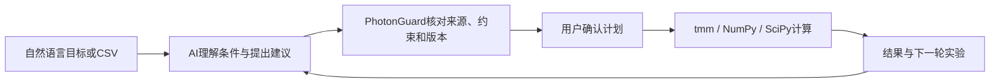

# PhotonGuard

当前版本：`0.2.0rc28`（预发布）。PhotonGuard 是面向光电学生的 AI 光学学习与实验工作台。光学知识库收录 1011 条可离线查阅的条目和 31 个学习专题，支持独立运行。[使用与回退](docs/总决赛研发版使用指南.md)

**让光学实验从一句需求开始，也能带着结果继续。**

AI 光学学习与实验工作台 · `0.2.0rc28` · GPL-2.0-or-later

PhotonGuard 将自然语言目标、实验条件、数值计算和后续分析组织在同一个任务中。使用者可以描述目标、导入 CSV、比较候选，再带着已保存的结果修改目标或安排下一次观测。

[快速开始](#快速开始) · [目标驱动单缝与光学助教](docs/总决赛研发版使用指南.md) · [实际案例](#实际案例) · [AI连接与额度](docs/使用指南.md#ai连接与次数设置)


## PhotonGuard 能做什么

- **从一句需求形成计算计划。** AI 整理条件与单位，工作台核对原文来源、缺项和范围，用户确认后进入计算。
- **按目标生成缝宽候选。** 给出目标宽度与缝宽范围，程序先用焦平面公式生成候选，批准后输出实际曲线与二维光强。
- **针对当前结果追问。** 助教引用已保存的候选、图轴和出处，可先预测变化，再准备待批准的对照实验。
- **独立查阅光学知识。** 断网可搜索正文、浏览公式和来源。连接 AI 后可选择基于当前资料串讲，也可按前置知识自学。
- **带着学习问题验证。** 单缝焦平面条件可进入待核对计划，膜厚问题可接续导入观测。计算后带着实际结果回到同一段学习，摘要可保留预测、结果和出处。
- **拆开变化并恢复参照目标。** 单缝可逐项看波长、焦距与缝宽的解析作用，并在固定目录或允许范围内核对恢复方案。
- **修改目标时保留实验条件。** 条件、计划、结果按版本保存；已有数值满足新评价要求时直接复用。
- **让下一步建议接上工具。** AI 在允许范围内提出后续观测建议，用户批准后执行并联合分析。
- **从已有案例或自己的数据开始。** 提供12个本地案例，支持CSV输入、结果查看与导出。

| 场景 | 设计与比较 | 数据分析 |
|---|---|---|
| 薄膜 | 比较层数与反射、透射结果 | 根据校准反射率和已知折射率筛选膜厚候选 |
| 高斯光束 | 比较透镜条件与屏幕光斑 | 根据纵向光斑半径数据估计束腰参数 |
| 衍射 | 单缝、双缝的中心曲线与二维光强 | 根据强度数据估计受限几何参数 |

## AI 与开源工具怎样配合



AI 通过使用者自己的 DeepSeek API 账户接入，负责理解与建议；PhotonGuard 自主实现条件核对、计划绑定、执行管理和跨轮结果复用；开源数值工具产生实际计算结果。第三方库及其职责见[资源清单](THIRD_PARTY_NOTICE.md)。

## 快速开始

### 1. 下载完整项目

[下载当前项目 ZIP](https://github.com/zhou2022f1/PhotonGuard/archive/refs/heads/main.zip)，全部解压后进入包含本 README 的目录，保留 `app/` 和 `materials/` 的完整结构。该版本应用源码对应 `03f3a95af52317fa9d57d018fa3b07d65d1b2da5`；文件身份以 `app/SOURCE_MANIFEST.json` 核对。

### 2. 先看已有成果

双击 **查看示例结果.html**，查看单缝主示例及历史薄膜保存结果。这个入口无需API Key，也不会自动请求模型或计算。HTML应下载后在本机浏览器打开。

### 3. 启动工作台

启动器支持 **Windows x64 + Ubuntu WSL**。

1. 未安装Ubuntu WSL时，双击 **首次准备环境.bat**，按提示安装、重启，再打开Ubuntu完成用户名与密码设置。
2. 双击 **启动工作台.bat**。首次需要联网下载锁定的运行环境，后续启动复用缓存。
3. 等待启动窗口显示成功，浏览器会自动打开工作台。真实AI在页面“连接AI”中填写自己的DeepSeek API Key。
4. 核对计算计划并批准后执行新计算。使用结束时双击 **停止工作台.bat**。

本入口目前以Windows x64与Ubuntu WSL交付；macOS、ARM Windows与无WSL的原生Windows Python不在该启动器验证范围内。已有Linux环境的使用者可参考 [源码说明](app/source/README.md) 与 `app/source/START_PORTABLE.sh`。

首次依赖下载失败可检查网络后重新启动。若浏览器拒绝连接，先查看启动窗口是否成功，使用窗口给出的实际地址。更完整的说明见 [使用指南](docs/使用指南.md)。

## 实际案例

### 研发版单缝目标与助教

在首页「你想解决什么问题？」描述单缝目标，或在教学案例中打开单缝任务。整理并核对计划后运行。查看实际曲线与二维光强，从侧栏打开光学助教，可点选暗纹并问它的意义。需要验证新的条件时，先看解析预览，再核对并批准对照。[详细操作](docs/总决赛研发版使用指南.md)

### 省赛单缝案例

首页实验台下方点击 **填入这组示例条件**，再点 **开始这个任务**。固定波长633 nm、焦距200 mm、缝高100 μm，只比较16、20、24 μm缝宽。AI整理资料后，核对并批准快速计算，查看中心曲线和二维光强。

| 缝宽 | 中心到第一暗纹 | 目标6.33±0.05 mm |
|---|---:|---|
| 16 μm | 7.9125 mm | 不在目标范围 |
| **20 μm** | **6.3300 mm** | **达到目标** |
| 24 μm | 5.2750 mm | 不在目标范围 |


以上来自2026-10-20保存的实际运行：2次真实AI请求整理条件与核对原文，3个候选各作双网格核对，共6次快速场计算。第一暗纹指标按λf/a计算；曲线和二维图来自实际NumPy FFT数组。新任务按实际运行结果判断。

未改动的首页内置示例也可直接点击“用本地规则整理计划”，无需连接AI；整理后核对计划并批准计算。AI整理和本地整理可分别使用。

完整操作见[单缝入门示例](docs/单缝入门示例.md)；下载后可直接打开[保存结果](materials/single-slit.html)，数据来源见[单缝示例记录](materials/单缝示例记录.json)。

### 更多已有成果：850 nm薄膜达标设计

历史任务比较2、4、6、8层，850 nm反射率分别为15.09%、45.58%、71.00%、86.02%；8层达到75%目标。查看[薄膜保存结果](materials/film-initial.html)和[原始采样与后续记录](materials/主案例采样与调用阶段核对.json)。

### 安排下一次观测：膜厚候选12组收窄至1组

历史教学合成任务在0–1000 nm搜索范围内，利用633 nm观测得到12组候选。AI选择后续850 nm观测，经批准取得教学数据，与原数据联合分析，保留1组约208.19 nm的候选。

该案例体现补充观测与工具接续，来源为教学合成数据。详见 [历史案例记录](materials/历史12到1案例核对.json)。

## AI 请求次数可调

打开工作台的 **连接 AI → 连接 DeepSeek**，设置“本工作区累计 AI 请求上限”。默认20次，可按需设置200、1000或更多次；提高上限后，使用自己的Key重新连接即可继续。

这里统计的是实际模型请求，不是任务数或点击次数；一次整理可能包含多次请求。重启和断开连接不会清零，失败或状态不明的已发送请求也可能占用次数。已取消100次固定上限，已用次数在重启和调整额度后继续保留。费用由个人DeepSeek账户承担，次数上限不等于金额预算。详见[使用指南](docs/使用指南.md#ai连接与次数设置)。

知识问答会结合用户原话整理追问，再根据相关正文生成和核对答复，一次 AI 讲解通常包含 2—3 次模型请求。本地搜索、阅读和登记公式计算可离线使用。

## 代码与复用

```text
PhotonGuard/
├─ README.md
├─ LICENSE
├─ 启动工作台.bat
├─ 首次准备环境.bat
├─ 停止工作台.bat
├─ 查看示例结果.html
├─ app/
│  ├─ launcher/              WSL启动与环境准备
│  └─ source/
│     ├─ photonguard/        产品代码、页面与本地案例
│     ├─ tests/             软件测试
│     └─ pyproject.toml     项目依赖与入口
├─ materials/               只读结果与案例记录
└─ docs/                    使用指南与交付来源
```

工作台的个人任务保存在 `app/data/`，日志位于 `app/logs/`，两者均从Git上传范围排除。Key通过页面连接，不要写入代码或提交到仓库。

`app/` 包含目标驱动单缝和光学助教，启动器会核对当前源码清单。修改代码时可按源码说明在独立开发副本中运行。

当前候选版以已验收的 `0.2.0rc10` 研发快照为起点，历史记录与当前运行包分别对应各自清单。[交付来源](docs/交付来源.md)

## 许可证与第三方资源

项目代码采用 **GPL-2.0-or-later**，见 [LICENSE](LICENSE)。Python、NumPy、SciPy、tmm等依赖沿用各自许可；DeepSeek使用远程API服务。完整列表见 [第三方资源清单](THIRD_PARTY_NOTICE.md) 与 [第三方说明](THIRD_PARTY_NOTICE.md)。

安装环境、模型权重、个人密钥和私人实验记录不随仓库分发。随附案例与截图由本项目保存；历史反向案例使用教学合成数据。

## 反馈与维护

反馈时请提供使用的版本、系统、操作步骤与错误信息。共享日志前请去除 Key 和个人数据。省赛公开版可在项目 Issues 反馈。[公开项目 Issues](https://github.com/zhou2022f1/PhotonGuard/issues)

本版新增两版单缝 FFT 对比视图和 FRET 当前控件值追问。源码与运行包以随附提交清单为准；当前候选尚未发布至公共仓库。

## 知识与数值扩展

[知识条目格式](knowledge-schema.md)记录正文、来源、权利状态、适用条件、公式变量和关键结论的组织方式。团队组织知识结构，借助 AI 整理中文讲解，并通过来源定位、公式检查和重点抽查维护内容。

实验结果与登记公式的关键数值由程序核算，AI 负责理解目标、组织方案和解释结果。新的实验求解须经用户批准。
